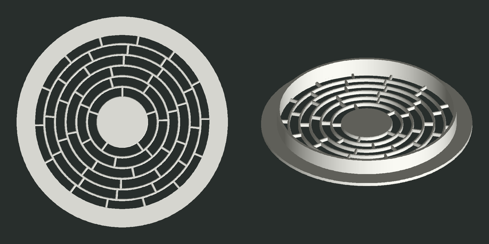

# Решётка вентилятора 140 мм — «Кольца»

Решётка с фланцем для круглого отверстия Ø140 мм в стенке из ДСП 16 мм. Сделана под вентилятор ARCTIC P14, прикрученный изнутри вплотную к стенке. Решётка вклеивается в отверстие: втулка заходит внутрь, фланец ложится снаружи на стенку.

Узор состоит из шести концентрических щелей шириной ~6,7 мм. Перемычки между щелями расставлены в шахматном порядке. Открытая площадь составляет 72% проёма.

## Файлы

- [grille_140_A.3mf](grille_140_A.3mf) — для Bambu Studio и других слайсеров.
- [grille_140_A.stl](grille_140_A.stl) — тот же файл в формате STL.

## Размеры

- Фланец Ø164 × 3 мм, фаска 0,6 мм по лицевой кромке.
- Втулка Ø139,6 мм, это зазор 0,2 мм на сторону под клей. Стенка втулки 2 мм, глубина 13 мм, до рамки вентилятора остаётся 3 мм.
- Центральный диск Ø40 мм. Мотор P14 имеет Ø50 мм, так что диск поток не перекрывает.
- Рёбра 1,6 мм с фаской 0,4 мм по кромкам с обеих сторон. Толщина решётки 3 мм.

## Печать

Деталь печатается фланцем на стол, поддержки не нужны. В файле 3MF модель уже стоит так.

- Слой 0,2 мм, 3–4 периметра, заполнение 15–20%.
- Пластик PETG или PLA, уходит около 45 г.

## Установка

Нанесите клей на втулку или на край отверстия, вставьте решётку и прижмите фланец к стенке.

Модель собирается скриптом [grille.py](../grille.py) в корне репозитория, все размеры задаются там параметрами.
