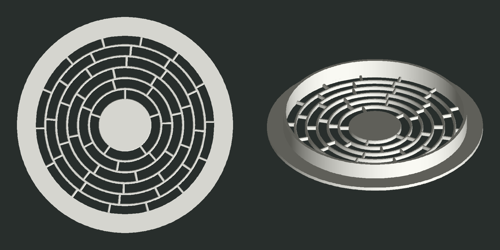
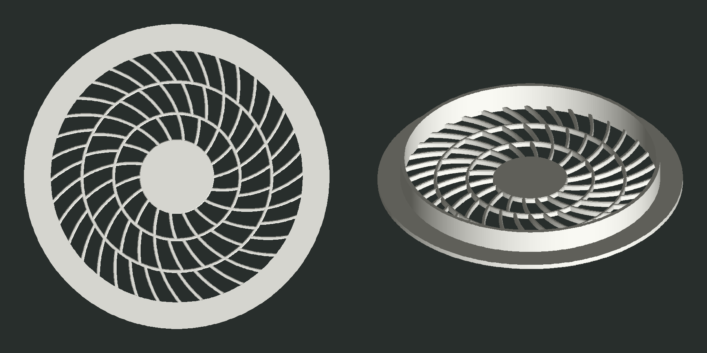

# Решётка для вентилятора 140 мм

Решётка с фланцем для отверстия Ø140 мм в стенке из ДСП 16 мм, за которой стоит вентилятор ARCTIC P14. Решётка вклеивается в отверстие: втулка заходит внутрь, фланец ложится снаружи на стенку.

| A — «Кольца» | B — «Вихрь» |
|---|---|
|  |  |
| папка [A-rings](A-rings/) | папка [B-swirl](B-swirl/) |
| открыто 72% проёма | открыто 70% проёма |

На превью решётка показана со стороны втулки, то есть так, как она стоит на столе принтера.

## Размеры

- Фланец Ø164 × 3 мм, фаска 0,6 мм по лицевой кромке.
- Втулка Ø139,6 мм: зазор 0,2 мм на сторону под клей. Стенка 2 мм, глубина 13 мм, так что до рамки вентилятора остаётся 3 мм.
- Центральный диск Ø40 мм. Мотор P14 имеет Ø50 мм, поэтому диск не перекрывает поток.
- Рёбра 1,6 мм с фаской 0,4 мм по кромкам с обеих сторон, толщина решётки 3 мм.

## Печать

Файлы 3MF уже сориентированы: модель стоит фланцем на столе, поддержки не нужны.

Настройки, которые я рекомендую:

- слой 0,2 мм;
- 3–4 периметра;
- заполнение 15–20%;
- PETG или PLA.

## Как изменить размеры

Все размеры задаются параметрами в начале [grille.py](grille.py). После правки пересоберите модели:

```sh
python3 -m venv .venv
.venv/bin/pip install -r requirements.txt
.venv/bin/python grille.py        # оба варианта
.venv/bin/python grille.py B      # только B
```
